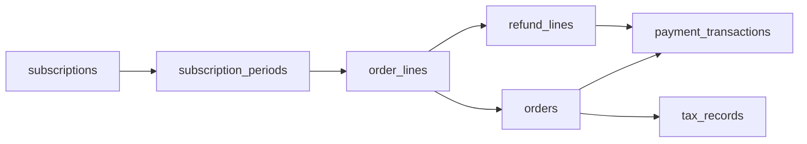
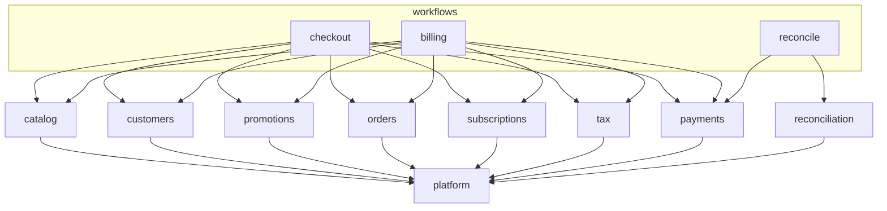
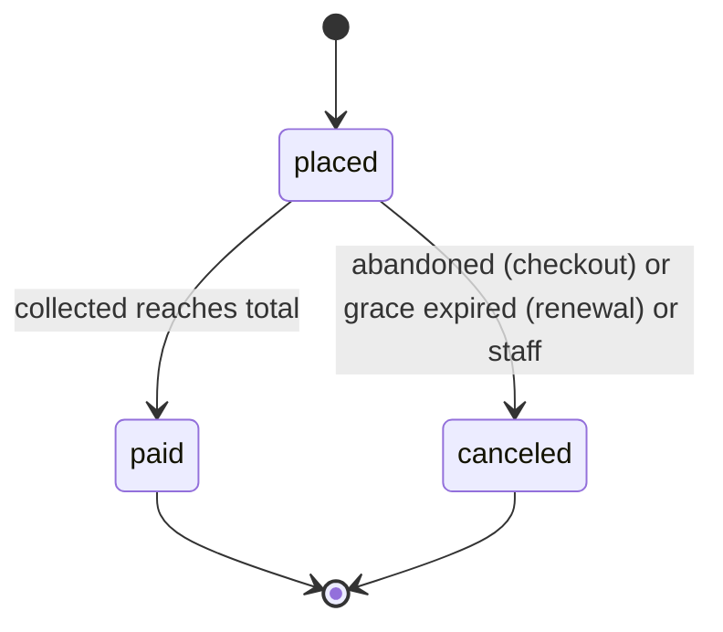
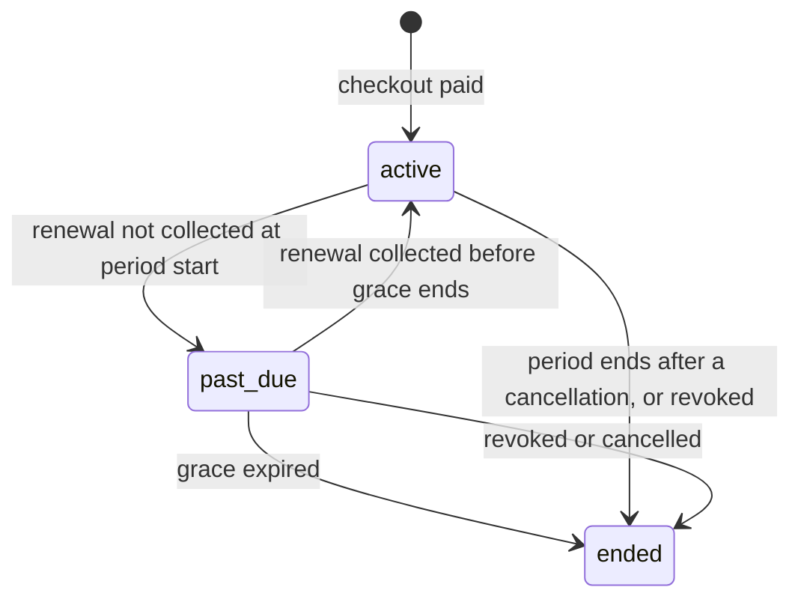
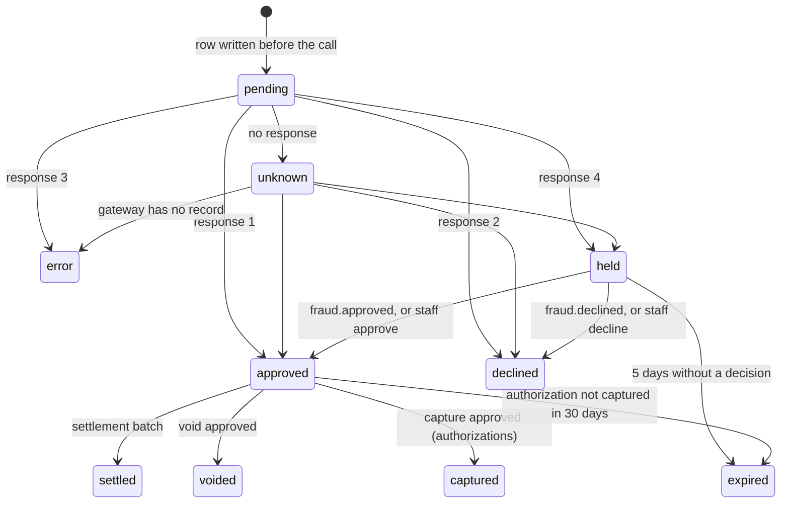

# Data model: catalog, orders, subscriptions and payments

This is the schema the backend builds for selling one-time digital goods, subscriptions and physical goods. It is
the reference that the migrations and the code follow, and it changes with them. Why the model is shaped this way
is recorded in [ADR 0002](adr/0002-orders-subscriptions-and-payments-data-model.md). The research behind it,
including the Authorize.Net sandbox experiments, is on #29.

## The mental model

An **order** is one billing event, and once placed it is the frozen record of what was charged. A **subscription**
is the standing agreement. A checkout order bills everything bought together. After that, each cycle of each
subscription gets its own small **renewal order**, so one order, payment, tax and refund path serves every kind of
product.

| Thing | What it is | How many |
| --- | --- | --- |
| Product | One sellable SKU, either physical or digital | One per thing in the catalog |
| Price | One way to pay for a product: one-time, monthly or yearly | Several live per product, at most one per interval |
| Shipping method | A flat-rate way to ship physical goods | A handful |
| Order | What was charged on one date, frozen once placed | One per checkout, then one per subscription per cycle |
| Order line | One product, or the shipping, on an order | One per product bought, plus one for shipping |
| Subscription | The customer's agreement, at its current price | One per subscription product bought |
| Billing period | One cycle of one subscription | One per cycle, linked to the order line that billed it |
| Payment session | One hosted checkout form | One open per checkout order at a time |
| Payment transaction | One call to Authorize.Net, or one attempt it reported | Many per order |
| Tax record | One Stripe Tax calculation, or the transaction or reversal made from it | One per order, plus one per refund |

The path from an agreement to its money:

## Domains

Each table belongs to one domain package, which alone writes it (ADR 0002). Foreign keys can cross domains, but
Go imports can't. The `checkout`, `billing` and `reconcile` workflow components coordinate several domains in one
database transaction.

| Domain | Tables |
| --- | --- |
| `catalog` | `products`, `prices`, `shipping_methods` |
| `customers` | `customers`, `customer_addresses` |
| `promotions` | `promotions`, `promotion_products`, `promotion_redemptions` |
| `orders` | `orders`, `order_addresses`, `order_lines`, `shipments`, `shipment_lines`, `returns`, `return_lines`, `entitlements` |
| `subscriptions` | `subscriptions`, `subscription_periods`, `price_transitions`, `subscription_price_changes`, `subscription_discounts`, `subscription_notices`, `terms_versions`, `subscription_consents` |
| `tax` | `tax_records` |
| `payments` | `payment_methods`, `payment_sessions`, `payment_transactions`, `refund_lines` |
| `reconciliation` | `gateway_batches`, `gateway_transactions`, `reconciliation_discrepancies` |
| `platform` | `idempotency_keys`, `outbox_messages`, `inbox_messages`, `audit_events` |

## Conventions

- **Keys.** `id bigint GENERATED ALWAYS AS IDENTITY PRIMARY KEY`, unless a table says otherwise. Customers see
  order numbers, never IDs.
- **Money.**
  - Amounts are `bigint` cents, never floats or `numeric`.
  - Each table that owns amounts has one `currency char(3) NOT NULL CHECK (currency = 'USD')`. Its rows' amounts
    are all in that currency.
  - Amount columns end in `_amount` and carry `CHECK (… >= 0)`, unless signed.
- **Percentages** are basis points (`10000` is 100%).
- **Rounding.**
  - An amount computed for one line, such as a percentage discount, rounds half up.
  - An amount split across lines uses the largest-remainder method. Each line gets the floor of its exact share. The
    cents still unallocated then go one each to the lines with the largest fractional remainders, with ties to the
    lowest `line_no`. So the parts always add up to the whole.
- **Time.**
  - Instants are `timestamptz`; billing dates are `date`, in UTC.
  - Business code reads the time only through `clock.Clock`.
  - Date rules are inclusive: "through 15 Feb" means access on 15 Feb.
- **Enumerations** are `text` with a `CHECK (… IN (…))`. Adding a value is a migration.
- **Immutable rows.** Prices, placed order lines, terms versions, consents and audit events are never updated,
  except for the columns named as settable once. A trigger rejects any other update.
- **Countries.** Every address has `country char(2) CHECK (country = 'US')` (D-9).
- **Postgres 18.** The model uses partial unique indexes and `NULLS NOT DISTINCT`.

## Catalog

### products

| Column | Type | Notes |
| --- | --- | --- |
| id | bigint, PK | |
| slug | text, unique | `^[a-z0-9]+(-[a-z0-9]+)*$`; the URL name |
| sku | text, unique | The stock-keeping code; one product is one SKU (D-10) |
| kind | text | `physical` or `digital`. Physical lines need a shipping address and are shipped; digital ones are delivered or granted |
| name | text | 1 to 200 characters |
| description | text | |
| tax_code | text | Stripe Tax code, for example `txcd_99999999` (tangible goods) or `txcd_10503000` (stand-alone documents); for an accountant to confirm |
| status | text | `draft`, `active` or `archived`; only `active` products can be bought |
| created_at | timestamptz | |

Whether a product recurs is decided by its price, not by the product. So a monthly candle box is a physical product
with a monthly price.

### prices

| Column | Type | Notes |
| --- | --- | --- |
| id | bigint, PK | |
| product_id | FK products | |
| currency | char(3) | `USD` |
| unit_amount | bigint | List price in cents, before any promotion |
| interval | text, nullable | `month` or `year` makes the price recurring; null is one-time |
| interval_count | smallint, nullable | `1` is every interval, `3` with `month` is quarterly; null when one-time |
| created_at | timestamptz | |
| retired_at | timestamptz, nullable | Stops new sales; settable once. Existing subscriptions keep the price |

- `CHECK ((interval IS NULL) = (interval_count IS NULL))`.
- At most one live price per product, currency and interval: `CREATE UNIQUE INDEX … ON prices
  (product_id, currency, interval, interval_count) NULLS NOT DISTINCT WHERE retired_at IS NULL`.
- Prices are never edited. A new price is a new row.
- Retiring a price stops new sales, but moves no one. Subscribers move only through a price transition.

### shipping_methods

| Column | Type | Notes |
| --- | --- | --- |
| id | bigint, PK | |
| code | text, unique | For example `standard` or `express` |
| name | text | As shown at checkout |
| currency | char(3) | `USD` |
| amount | bigint | Flat rate per order, in cents |
| tax_code | text | Stripe Tax shipping code, for example `txcd_92010001` |
| active | boolean | |

Rates by weight or zone are deferred; a flat rate per order is enough for this catalog.

## Customers

### customers

| Column | Type | Notes |
| --- | --- | --- |
| id | bigint, PK | |
| email | text | Unique case-insensitively: `CREATE UNIQUE INDEX … ON customers (lower(email))` |
| name | text | |
| gateway_customer_profile_id | text, unique, nullable | Authorize.Net CIM customer profile. The backend creates it, with no payment profile, before the customer's first hosted session |
| created_at | timestamptz | |

Sign-in, passwords and sessions belong to the users domain, which a later issue designs. A customer row is the
buyer, whether or not they have an account.

### customer_addresses

| Column | Type | Notes |
| --- | --- | --- |
| id | bigint, PK | |
| customer_id | FK customers | |
| name, line1, line2, city | text | `line2` nullable |
| region | char(2) | US state code |
| postal_code | text | `^[0-9]{5}(-[0-9]{4})?$` |
| country | char(2) | `US` |
| is_default_billing, is_default_shipping | boolean | At most one default of each kind per customer: partial unique indexes where true and not removed |
| created_at | timestamptz | |
| removed_at | timestamptz, nullable | Addresses are removed, never deleted, because subscriptions point at them |

## Orders

### orders

| Column | Type | Notes |
| --- | --- | --- |
| id | bigint, PK | |
| number | text, unique | The number the customer sees, for example `RSL-2026-000123`; also the Stripe Tax transaction reference |
| customer_id | FK customers | |
| kind | text | `checkout` or `renewal` |
| status | text | `placed`, `paid` or `canceled` (state machine below) |
| currency | char(3) | `USD`; every amount on the order and its lines |
| subtotal_amount | bigint | Sum of product lines' `quantity × unit_amount` |
| discount_amount | bigint | Sum of the lines' discounts |
| shipping_amount | bigint | Sum of shipping lines' net amounts |
| tax_amount | bigint | Sum of the lines' tax |
| total_amount | bigint | `CHECK (total_amount = subtotal_amount - discount_amount + shipping_amount + tax_amount)`; the amount due |
| placed_at | timestamptz | When the order was written; there are no draft orders |
| paid_at | timestamptz, nullable | Set in the same transaction that makes collected reach the total |
| canceled_at | timestamptz, nullable | |
| cancel_reason | text, nullable | `abandoned`, `grace_expired` or `staff` |
| expires_at | timestamptz, nullable | Checkout orders only: `placed_at + 24 hours`, when an unpaid order may be abandoned |

- `CHECK ((status = 'paid') = (paid_at IS NOT NULL))` and `CHECK ((status = 'canceled') = (canceled_at IS NOT NULL))`.
- There is no draft order. The cart and price preview are computed without writing rows, and an order exists only
  once checkout places it, with every amount frozen.
- An order whose total is zero, for example after a 100% discount, is `paid` when it is placed, with no
  transaction.

Refunds and chargebacks never change `status`. They are reported beside it (see "What counts as collected").

### order_addresses

| Column | Type | Notes |
| --- | --- | --- |
| order_id | FK orders | Primary key with `role` |
| role | text | `billing` or `shipping` |
| name, line1, line2, city, region, postal_code, country | as in customer_addresses | A copy made at placement and never updated |

- Every order has a billing address.
- An order with a physical line also has a shipping address, which checkout and billing check before inserting.
- A renewal copies the subscription's current addresses, so a customer who moves is taxed by the new state from
  the next renewal.

### order_lines

| Column | Type | Notes |
| --- | --- | --- |
| id | bigint, PK | |
| order_id | FK orders | |
| line_no | smallint | `UNIQUE (order_id, line_no)` |
| kind | text | `product` or `shipping` |
| product_id | FK products, nullable | Set when `kind = 'product'` |
| price_id | FK prices, nullable | Set when `kind = 'product'`; the price the line was sold at |
| shipping_method_id | FK shipping_methods, nullable | Set when `kind = 'shipping'` |
| subscription_id | FK subscriptions, nullable | Set on renewal lines. A checkout line that starts a subscription is that subscription's `origin_order_line_id` |
| description | text | As printed on the receipt |
| quantity | int | `>= 1`; always 1 on a recurring price or a shipping line |
| unit_amount | bigint | Copied at placement |
| discount_amount | bigint | Zero when no promotion applies |
| promotion_redemption_id | FK promotion_redemptions, nullable | The redemption behind the discount |
| net_amount | bigint, generated | `quantity * unit_amount - discount_amount`, `CHECK (>= 0)`; what tax is calculated on |
| tax_amount | bigint | Frozen from the tax calculation at placement |
| total_amount | bigint, generated | `quantity * unit_amount - discount_amount + tax_amount`. Postgres doesn't let a generated column refer to another one, so it repeats `net_amount`'s expression |
| tax_code | text | Copied from the product or shipping method at placement |

- `CHECK` that the columns for the line's `kind` are set and the others are null.
- Placed lines are immutable.

### shipments and shipment_lines

| shipments column | Type | Notes |
| --- | --- | --- |
| id | bigint, PK | |
| order_id | FK orders | |
| status | text | `pending`, `shipped`, `delivered`, `returned_to_sender` or `canceled` |
| carrier, service, tracking_number | text, nullable | |
| created_at, shipped_at, delivered_at | timestamptz | `shipped_at` and `delivered_at` nullable |

| shipment_lines column | Type | Notes |
| --- | --- | --- |
| shipment_id | FK shipments | Primary key with `order_line_id` |
| order_line_id | FK order_lines | A physical product line |
| quantity | int | `>= 1` |

- An order's physical lines are shipped once it is paid.
- One order can have several shipments.
- The quantity shipped per line, across shipments that aren't cancelled, never exceeds the line's quantity. The
  orders domain checks this while holding the order row locked.

### returns and return_lines

| returns column | Type | Notes |
| --- | --- | --- |
| id | bigint, PK | |
| order_id | FK orders | |
| status | text | `requested`, `approved`, `received`, `refunded`, `rejected` or `canceled` |
| reason | text | |
| requested_at, received_at | timestamptz | `received_at` nullable |
| refund_transaction_id | FK payment_transactions, nullable | The reversal issued for it: a refund, or a void before settlement |

| return_lines column | Type | Notes |
| --- | --- | --- |
| return_id | FK returns | Primary key with `order_line_id` |
| order_line_id | FK order_lines | |
| quantity | int | `>= 1`; across returns not rejected or cancelled, never more than was shipped |

A physical line is refunded after its return is received. Staff can refund without a return, for example for an
item lost in transit, and that refund is audited.

### entitlements

| Column | Type | Notes |
| --- | --- | --- |
| id | bigint, PK | |
| customer_id | FK customers | |
| product_id | FK products | A digital product |
| order_line_id | FK order_lines, unique | The line that bought it |
| granted_at | timestamptz | When the order became paid |
| revoked_at | timestamptz, nullable | |
| revoke_reason | text, nullable | `refunded`, `chargeback` or `staff` |

- A one-time digital purchase grants an entitlement in the same transaction that marks its order paid.
- It is revoked once the line's reversals reach its whole `total_amount`, or by a lost chargeback. Reversals are refunds plus voids, summed across all of them.
- Subscriptions grant access through their own dates (see "Access"), not through entitlements.

## Promotions

### promotions

| Column | Type | Notes |
| --- | --- | --- |
| id | bigint, PK | |
| name | text | Internal name |
| code | text, nullable | What the customer types; unique case-insensitively (`CREATE UNIQUE INDEX … ON promotions (lower(code))`); null means it applies automatically |
| discount_kind | text | `percent` or `amount` |
| percent_off_bp | int, nullable | 1 to 10000; set when `percent` |
| amount_off | bigint, nullable | Cents; set when `amount`, together with `currency` |
| currency | char(3), nullable | Set exactly when `amount_off` is: `CHECK ((amount_off IS NULL) = (currency IS NULL))` and `CHECK (currency IS NULL OR currency = 'USD')` |
| applies_to | text | `all` or `listed` products |
| duration | text | `once`, `repeating` or `forever`; matters for subscriptions |
| duration_cycles | smallint, nullable | Billing cycles, counting the checkout's; set only when `repeating` |
| starts_at, ends_at | timestamptz, nullable | The window in which it can be redeemed |
| max_redemptions, max_redemptions_per_customer | int, nullable | |
| created_at, archived_at | timestamptz | `archived_at` nullable |

- `CHECK (duration = 'once' OR discount_kind = 'percent')`. A fixed amount split across a mixed checkout has no
  clear value on a later single-line renewal.

### promotion_products

| Column | Type | Notes |
| --- | --- | --- |
| promotion_id, product_id | FKs | The primary key; rows exist only when `applies_to = 'listed'` |

### promotion_redemptions

| Column | Type | Notes |
| --- | --- | --- |
| id | bigint, PK | |
| promotion_id | FK promotions | |
| order_id | FK orders, unique | The checkout order that used it. `UNIQUE (order_id)` enforces one promotion per order |
| customer_id | FK customers | |
| redeemed_at | timestamptz | |
| released_at | timestamptz, nullable | Set when the order is cancelled, which gives the use back |

- Usage is a count of rows with `released_at IS NULL`.
- The redemption is inserted in the order's own transaction, after `SELECT … FOR UPDATE` on the promotion. So two
  checkouts racing for the last use can't both get it, and the per-customer limit holds too.

### Discount rules

| Rule | Choice |
| --- | --- |
| One promotion per order | Promotions don't stack. Checkout applies the single best eligible one |
| Which lines | Product lines the promotion applies to. Shipping lines are never discounted (free shipping is deferred) |
| Percent | Each line's discount is `round_half_up(quantity × unit_amount × percent_off_bp / 10000)` |
| Fixed amount | Split across the eligible lines in proportion to their `quantity × unit_amount` by the largest-remainder method (Conventions), capped at the eligible lines' total |
| Renewals | A renewal discount points back at the original redemption and isn't a new use |

### subscription_discounts

| Column | Type | Notes |
| --- | --- | --- |
| id | bigint, PK | |
| subscription_id | FK subscriptions | At most one active per subscription |
| promotion_redemption_id | FK promotion_redemptions | The checkout redemption that granted it |
| percent_off_bp | int | Copied from the promotion |
| cycles_remaining | smallint, nullable | Discounted renewals still to come; null for `forever` |

- Created only for a `repeating` or `forever` promotion. A `once` promotion discounts the checkout line alone.
- `cycles_remaining` starts at `duration_cycles - 1` for `repeating`, because the checkout used the first cycle. It is null for `forever`.
- The renewal puts the discount on the new line, and lowers `cycles_remaining`, in the same transaction.
- Counting cycles rather than dates means a late payment or a short month can't add or drop a discounted cycle.

## Subscriptions

### subscriptions

| Column | Type | Notes |
| --- | --- | --- |
| id | bigint, PK | |
| customer_id | FK customers | |
| origin_order_line_id | FK order_lines, unique | The checkout line that started it |
| price_id | FK prices | The agreed recurring price; the product comes from it |
| payment_method_id | FK payment_methods | The card renewals charge. A subscription is created only once its checkout has saved a card (see Checkout) |
| billing_address_id | FK customer_addresses | Copied onto each renewal order |
| shipping_address_id | FK customer_addresses, nullable | Required when the product is physical |
| shipping_method_id | FK shipping_methods, nullable | Required when the product is physical. Each renewal adds a shipping line at the method's current amount |
| status | text | `active`, `past_due` or `ended` |
| anchor_day | smallint | 1 to 31: the day of the month the subscription renews on |
| started_at | timestamptz | |
| current_period_start, current_period_end | date | The cycle billed most recently; `current_period_end` is the next renewal date |
| paid_through | date | The `period_end` of the last cycle actually paid for, inclusive, so renewal day keeps access until the renewal has run |
| grace_ends_on | date, nullable | Set while `past_due` |
| next_attempt_at | timestamptz, nullable | The next collection attempt while `past_due` |
| cancel_at_period_end | boolean | |
| cancel_requested_at | timestamptz, nullable | |
| cancel_channel | text, nullable | `web`, `email` or `support` |
| save_offer_shown_at | timestamptz, nullable | At most one save offer per cancellation (D-8) |
| ended_at | timestamptz, nullable | |
| end_reason | text, nullable | `canceled`, `grace_expired`, `revoked` or `staff` |

- `CHECK ((status = 'past_due') = (grace_ends_on IS NOT NULL))`.
- `CHECK ((status = 'ended') = (ended_at IS NOT NULL))`.
- `CHECK ((shipping_address_id IS NULL) = (shipping_method_id IS NULL))`. Both are set for physical products, which the `billing` workflow checks against the product.
- An ended subscription is never reactivated. A returning customer gets a new one.
- Pausing isn't supported.

### Access

**A subscription gives access when** it isn't `ended` and today, in UTC, is on or before `paid_through`, or on or
before `grace_ends_on` while `past_due`.

`current_period_end` plays no part in access. It moves when a renewal is created, before anyone has paid. Renewal day itself is covered:
`paid_through` is the paid period's end date, the day the next period starts, and it is inclusive. So access
holds on renewal day until the renewal job has run, and then follows that renewal's outcome.

**Grace (D-6).** A renewal that isn't collected by its period start sets `past_due`, with
`grace_ends_on = period_start + 7 days`. That happens whether the charge was declined, is unknown, or is held for
fraud review. The rule is the same in all three cases, and seven days outlasts a 5-day fraud hold.

### The billing anchor

`anchor_day` is the day of the month from `started_at`. Each period ends on the anchor day of the next interval,
clamped to that month's length: 31 Jan → 28 Feb → 31 Mar → 30 Apr → 31 May. Yearly periods use the same anchor
month and day, with 29 Feb clamped to 28 Feb. A renewal paid late still covers the period that began on the anchor
date; it doesn't move the anchor.

### subscription_periods

| Column | Type | Notes |
| --- | --- | --- |
| id | bigint, PK | |
| subscription_id | FK subscriptions | |
| period_start, period_end | date | `CHECK (period_end > period_start)`; half-open, `[start, end)` |
| order_line_id | FK order_lines, unique | The line that billed this cycle, which also carries the price it was billed at |

- `UNIQUE (subscription_id, period_start)`. If a renewal runs twice for the same period, the second insert fails,
  and so does its whole transaction, order and line included.
- This stops a second order. Two charges on one order are stopped by the payments rules.

### subscription_price_changes

| Column | Type | Notes |
| --- | --- | --- |
| id | bigint, PK | |
| subscription_id | FK subscriptions | |
| price_transition_id | FK price_transitions | The decision this change carries out |
| from_price_id, to_price_id | FK prices | Copied from the transition |
| effective_on | date | The renewal date it is scheduled for, which is that cycle's `period_start` |
| notice_id | FK subscription_notices, unique | Required: a change can't exist without its notice |
| status | text | `scheduled`, `applied`, `rescheduled` or `canceled` |
| applied_order_line_id | FK order_lines, nullable | The first line billed at the new price |
| created_at | timestamptz | |

- At most one scheduled change per subscription: a partial unique index on `subscription_id` where
  `status = 'scheduled'`.

### price_transitions

| Column | Type | Notes |
| --- | --- | --- |
| id | bigint, PK | |
| from_price_id | FK prices | The price subscribers move away from |
| to_price_id | FK prices | The price they move to; same product, currency and interval |
| decided_at | timestamptz | |
| decided_by | text | The staff member, also written to `audit_events` |
| status | text | `active`, `completed` (no subscriber left on `from_price_id`) or `canceled` |

- At most one active transition per `from_price_id`.
- Retiring a price alone keeps its subscribers on it. A transition is what moves them, and it names exactly where to.

**How a price change rolls out:**
1. A new row goes into `prices`, the old one is usually retired, and an `active` transition records the move.
2. Each day, the notice job finds subscriptions on an active transition's `from_price_id` whose next renewal is 10
   to 30 days away. For each, in one transaction, it writes a `price_change` notice and a `scheduled` change for
   that renewal. The notice goes out through the outbox. Starting at 10 days, not 7, leaves three days for mail
   delays.
3. At the renewal, the change applies only if the notice's send date (`sent_at` in UTC, as a date) is between 30
   and 7 days before `effective_on`, both inclusive: `effective_on - 30 <= sent_at::date <= effective_on - 7`. If
   it does, the subscription's `price_id` becomes `to_price_id`, the change is `applied`, and the new line bills the
   new price.
4. Otherwise, for example because the email bounced or the relay was down, the change becomes `rescheduled`. The
   renewal bills the old price, and step 2 picks the subscription up again for a later renewal.

So a price change reaches each subscription within one cycle of the decision. A monthly subscriber moves within
about a month, an annual one at their next yearly renewal, and nobody is ever charged a new price without a notice
sent inside the window.

### subscription_notices

| Column | Type | Notes |
| --- | --- | --- |
| id | bigint, PK | |
| subscription_id | FK subscriptions | |
| kind | text | `acknowledgment`, `price_change`, `promo_ending`, `pre_renewal`, `annual_reminder` or `cancellation_confirmation` |
| window_start, window_end | date | When it may be sent, from the schedule below. The notice job queues it on the first day of its window |
| status | text | `scheduled`, `queued`, `sent`, `failed` or `skipped` |
| outbox_message_id | FK outbox_messages, nullable | Set when queued |
| sent_at | timestamptz, nullable | Set when the mail relay accepts the message, not when the row is written |
| body | text, nullable | A copy of what was sent |
| created_at | timestamptz | |

`UNIQUE (subscription_id, kind, window_start)`, so the job can't schedule the same notice twice.

**The notice job** (`billing`) runs daily. For each subscription that isn't ended, it computes from the schedule
which `promo_ending`, `pre_renewal` and `annual_reminder` notices are due, and inserts any that are missing. It also
writes `price_change` notices for active price transitions, and queues every notice whose window has opened
through the outbox. The `acknowledgment` and `cancellation_confirmation` notices are written by the transactions
that cause them.

**The notice schedule.** It follows the California automatic renewal law (Bus. & Prof. Code § 17602), read as on
22 November 2026. It is an engineering reading, not legal advice.

| Kind | When | Content |
| --- | --- | --- |
| `acknowledgment` | Right after the checkout is paid | The renewal terms, the cancellation policy, how to cancel |
| `price_change` | 7 to 30 days before the renewal at the new price | The new price, and how to cancel |
| `promo_ending` | 3 to 21 days before a free or discounted period longer than 31 days ends | That it renews, the term, the price and frequency, how to cancel, a cancellation link, contact details |
| `pre_renewal` | 15 to 45 days before renewal, for terms of a year or more | As `promo_ending`. It replaces `promo_ending` when both would apply |
| `annual_reminder` | Each anniversary of `started_at`, in a window from 30 days before it to the anniversary itself, for every subscription (D-7). Skipped in a year when a `pre_renewal` notice already went out | The product, the frequency and amount of charges, how to cancel |
| `cancellation_confirmation` | Right after a cancellation is accepted | What ends and when |

### Cancellation

- Cancelling online takes one prominent link or button.
- A single save offer may be shown, always with "click to cancel" displayed alongside it (D-8).
- An ordinary cancellation sets `cancel_at_period_end`. The subscription stays `active` until `paid_through`,
  then ends with `end_reason = 'canceled'`.
- Revoking access ends it at once with `end_reason = 'revoked'`, for a full refund of a cycle, a lost chargeback
  or a staff decision. `paid_through` keeps its meaning
  (the end of the last period paid for), but an ended subscription has no access whatever its dates say.

### terms_versions and subscription_consents

Build these only if counsel confirms the consumer rules apply (D-3). They apply to consumers, not to businesses
buying for business use.

| terms_versions column | Type | Notes |
| --- | --- | --- |
| id | bigint, PK | |
| kind | text | `subscription_terms` or `renewal_disclosure` |
| body | text | The full text as published |
| published_at | timestamptz | Rows are never edited; new wording is a new row |

| subscription_consents column | Type | Notes |
| --- | --- | --- |
| id | bigint, PK | |
| order_line_id | FK order_lines | The checkout line the customer agreed to |
| terms_version_id | FK terms_versions | |
| price_id | FK prices | The price and frequency shown |
| disclosure_text | text | The exact words beside the checkbox |
| method | text | `checkbox`, unticked by default |
| accepted_at | timestamptz | |
| ip_address | inet | |
| user_agent | text | |

- The consent row is written at checkout, against the line, before any charge. So it exists even when the
  subscription is created later.
- It is never updated, and is kept for at least three years, or one year after the subscription ends, whichever
  is longer.

## Tax

Stripe Tax's standalone API calculates US sales tax (D-13). It works with any payment processor, so it needs no
Stripe payments.

### tax_records

| Column | Type | Notes |
| --- | --- | --- |
| id | bigint, PK | |
| order_id | FK orders | |
| kind | text | `sale` or `return` |
| refund_transaction_id | FK payment_transactions, nullable | Set on a return: the reversal (a refund, or a void of a collected charge) on the same order |
| currency | char(3) | `USD` |
| tax_amount | bigint | Matches the sum of the lines' tax on a sale, or the refund lines' tax on a return |
| calculation_id | text, unique, nullable | The Stripe Tax calculation (sales only) |
| calculation_expires_at | timestamptz, nullable | 90 days after it was made |
| reference | text, unique | The order number on a sale, or `<order number>-R<refund id>` on a return; unique across all Stripe Tax transactions, reversals included |
| stripe_transaction_id | text, unique, nullable | Set once recorded |
| status | text | `calculated`, `recorded` or `expired` |
| recorded_at | timestamptz, nullable | |

- At most one sale per order: a partial unique index on `order_id` where `kind = 'sale'`.
- At most one return per reversal: a partial unique index on `refund_transaction_id`.

| Event | What happens |
| --- | --- |
| Price preview | Stripe calculates. Nothing is stored |
| Order placed | The calculation's ID and lines are stored as a `calculated` sale, and its tax is frozen on the order lines. The calculation is made before the order's transaction; one that ends up unused simply expires |
| Order paid | A tax transaction is created from the calculation, with the order number as its reference, and the record becomes `recorded`. A repeated call is refused as a duplicate reference, which makes it idempotent |
| Order abandoned | Nothing is called. The calculation expires and the record becomes `expired` |
| Refund | A reversal is recorded with its own reference, for the refund lines' amounts and tax, as a `return` |

Each calculation takes one customer address: the shipping address when the order has a physical line, otherwise
the billing address. The shipping line goes to Stripe as `shipping_cost`, with its tax code. In the sandbox, Stripe
calculates tax only where a registration is configured, so the sandbox needs registrations.

## Payments

A transaction is one call to Authorize.Net, or one attempt Authorize.Net reported for a hosted session. Each one
belongs to exactly one order. Rows are added, never deleted.

### payment_methods

| Column | Type | Notes |
| --- | --- | --- |
| id | bigint, PK | |
| customer_id | FK customers | |
| gateway_payment_profile_id | text, unique | Authorize.Net CIM payment profile |
| brand | text | |
| last4 | char(4) | `^[0-9]{4}$`. No card number or CVV is ever stored |
| exp_month, exp_year | smallint | |
| created_at, removed_at | timestamptz | `removed_at` nullable |

A card saved on the hosted form is learned after the payment, from the transaction details, which carry the
customer and payment profile IDs.

### payment_sessions

| Column | Type | Notes |
| --- | --- | --- |
| id | bigint, PK | |
| order_id | FK orders | |
| reference | varchar(20), unique | Sent as the invoice number; Authorize.Net allows 20 characters |
| status | text | `open`, `completed` (an attempt was approved), `expired` (the token ran out without an approval seen) or `closed` (expired, and confirmed through the reporting API to have no attempt left unrecorded) |
| token_expires_at | timestamptz | 15 minutes after the token was issued |
| created_at, completed_at | timestamptz | `completed_at` nullable |

- At most one open session per order: a partial unique index on `order_id` where `status = 'open'`.
- A new session may be opened only when all of these hold:
  - the order has no transaction that is `pending`, `unknown` or `held`;
  - it has no collected charge;
  - every earlier session is `closed`.

  A session becomes `closed` once a sweep, at least 30 minutes after `token_expires_at`, has read the unsettled
  list and recorded every attempt under the session's reference. So a customer can't be charged in a second
  session while an attempt from the first is still unreported or under review.
- On the hosted form, a customer who is declined can try again. Each attempt the gateway reports under the
  session's invoice number becomes its own transaction row.

### payment_transactions

| Column | Type | Notes |
| --- | --- | --- |
| id | bigint, PK | |
| order_id | FK orders | |
| payment_session_id | FK payment_sessions, nullable | Set on attempts made on the hosted form |
| parent_id | FK payment_transactions, nullable | The charge or authorization that a capture, void, refund or chargeback acts on |
| kind | text | `charge`, `authorization`, `capture`, `void`, `refund` or `chargeback` |
| status | text | See the state machines below |
| currency | char(3) | `USD` |
| amount | bigint | `> 0`; a void's amount is its parent's |
| reference | varchar(20), unique, nullable | Calls the backend makes: sent as the invoice number and as `refId`, which webhooks echo back as `merchantReferenceId`. Null on hosted attempts, whose session holds the reference |
| gateway_transaction_id | text, nullable | Authorize.Net `transId`; an ID of `0` is stored as null |
| payment_method_id | FK payment_methods, nullable | |
| response_code | smallint, nullable | 1 approved, 2 declined, 3 error, 4 held |
| reason_code | int, nullable | |
| auth_code | text, nullable | |
| submitted_at | timestamptz | |
| resolved_at | timestamptz, nullable | When the outcome became known |
| approved_at | timestamptz, nullable | When the gateway approved it; set once, and kept when the row is later voided or settled |
| settled_at | timestamptz, nullable | |
| expires_at | timestamptz, nullable | Hold expiry (5 days) or authorization expiry (30 days) |

**Constraints:**
- `CHECK ((parent_id IS NULL) = (kind IN ('charge', 'authorization')))`.
- **Gateway IDs.** A gateway ID belongs only to the kinds that get one of their own: a unique index on
  `gateway_transaction_id` where `kind IN ('charge', 'authorization', 'refund')`. A void or capture returns its
  parent's ID, so it isn't stored on the void or capture row.
- **One open charge per order:** a unique index on `order_id` where `kind IN ('charge', 'authorization')`,
  `status IN ('pending', 'unknown', 'held')` and `payment_session_id IS NULL`. It covers the calls the backend
  makes. Hosted attempts have already happened by the time they are recorded, so they are always recorded; the
  session rules keep them to one session at a time.
- **One open operation per parent:** a unique index on `parent_id` where `kind IN ('refund', 'void', 'capture')`
  and `status IN ('pending', 'unknown')`. So a void and a refund, or a void and a capture, can't be open on the same
  charge at once.

**Charges and authorizations:**

- **Refunds, voids and captures** go `pending → approved | declined | error | unknown`, and a refund goes
  `approved → settled`. An unknown void or capture is resolved from its parent's transaction details:
  `voided` or `capturedPendingSettlement` means it was approved. An unknown refund is resolved like a charge (below).
- **A chargeback** is entered by staff from the processor's notice, because no webhook reports one. It is
  `disputed`, then `lost` or `won`.

### Charging rules

| Rule | How it works |
| --- | --- |
| Check before charging | Lock the order row and confirm it still has an outstanding balance before inserting a charge. A paid order is never charged again |
| Save before sending | The row is written as `pending`, with its reference, and committed before the gateway is called |
| Timeouts are unknown | A call with no response becomes `unknown`, never `declined` |
| Resolve, then retry | Every charge and refund the backend sends carries `duplicateWindow` 28800 (the maximum, 8 hours). To resolve an unknown one, it is resent unchanged. A duplicate error comes back as response 3 with error 11 and the original `transId`: the backend then reads that transaction's details and takes its status, rather than recording `error`. Past the window, the attempt is looked up by its invoice number in the unsettled list, and in the settled batches since its `submitted_at`. Only a confirmed decline, or confirmed absence from both, allows a new attempt, and a new attempt has a new reference |
| Holds | A held charge waits for `fraud.approved` or `fraud.declined`, or for a staff decision, which is audited. A sweep marks it `expired` after 5 days. While it waits, nothing else is charged on the order |
| Voids and captures | A void cancels a whole unsettled charge or authorization. A capture takes up to the authorized amount, once. Each is its own row, pointing at its parent, and on approval the parent's status changes. A void of a collected charge is a full refund before settlement: it goes through the refund path, with lines, tax reversal, revocations and an audit event |
| Refunds | Only a settled charge, within 180 days, can be refunded; before settlement it can only be voided. Refunds may be partial and repeated, up to the settled amount. No refund is issued on a charge with a `disputed` or `lost` chargeback |
| Chargebacks | A row entered by staff, pointing at the disputed charge, with its own generated reference |
| Unexpected collections | An approval may arrive for an order that is already paid or cancelled, for example a late webhook. It is recorded, then voided if unsettled or refunded if settled, and logged as an `unexpected_collection` discrepancy for staff. The order's status doesn't change |

### What counts as collected

| Amount | Definition |
| --- | --- |
| Due | The order's `total_amount` |
| Collected | `amount` of `charge` and `capture` rows with `approved_at` set, whatever their later status |
| Reversed | `amount` of `refund` rows that are `approved` or `settled`, plus approved `void` rows whose parent was collected |
| Charged back | `amount` of `chargeback` rows that are `lost` |
| Outstanding | Due minus collected. Reversals and chargebacks are reported beside it and never reopen it, so a `paid` order stays paid and is never charged again |

- An authorization holds funds but collects nothing.
- A declined, errored, expired or held charge collects nothing. A voided charge that was approved first did collect, and its void counts as a reversal.
- A capture can be for less than its authorization, so the capture's own amount is what counts.

### refund_lines

| Column | Type | Notes |
| --- | --- | --- |
| id | bigint, PK | |
| transaction_id | FK payment_transactions | A reversal: a `refund`, or a `void` of a collected charge. `UNIQUE (transaction_id, order_line_id)` |
| order_line_id | FK order_lines | Which line the money was for, shipping included |
| amount | bigint | The net amount refunded for the line |
| tax_amount | bigint | The tax refunded for the line |

- A reversal's `amount` equals the sum of its lines' `amount + tax_amount`. A void covers every line in full.
- For each order line, `amount + tax_amount` summed over every reversal not `declined` or `error` (pending and
  unknown ones included) never exceeds the line's `total_amount`. A lost chargeback uses up the rest of its
  charge's lines. The refund workflow checks this while holding the order row locked, and a constraint trigger
  checks it again.

## Reconciliation

These tables hold only what Authorize.Net reported, with its amounts converted to cents. The reconciliation
component alone writes them (D-12).

### gateway_batches

| Column | Type | Notes |
| --- | --- | --- |
| batch_id | text, PK | Authorize.Net settlement batch ID |
| settled_at | timestamptz | |
| settlement_state | text | As reported |
| first_seen_at, last_synced_at | timestamptz | |

### gateway_transactions

| Column | Type | Notes |
| --- | --- | --- |
| trans_id | text, PK | Authorize.Net transaction ID |
| batch_id | FK gateway_batches, nullable | Null until settled |
| transaction_type, transaction_status | text | As reported |
| invoice_number | text, nullable | The reference, when the backend or a session sent it |
| currency | char(3) | `USD`; the gateway account's currency |
| auth_amount, settle_amount | bigint | Cents |
| customer_profile_id, payment_profile_id | text, nullable | |
| submitted_at | timestamptz | |
| raw | jsonb | The payload as received, minus `billTo`, `shipTo`, `customer`, `customerIP` and `payment`. The masked card and the customer's details stay out of the mirror; the IDs and amounts above are what reconciliation needs |
| first_seen_at, last_synced_at | timestamptz | The sync updates rows as their status changes |

### reconciliation_discrepancies

| Column | Type | Notes |
| --- | --- | --- |
| id | bigint, PK | |
| kind | text | `missing_in_app`, `missing_in_gateway`, `amount_mismatch`, `status_mismatch` or `unexpected_collection` |
| payment_transaction_id | FK payment_transactions, nullable | |
| gateway_trans_id | text, nullable | |
| expected, actual | text | What the backend believed, and what the gateway reported |
| detected_at | timestamptz | |
| resolved_at | timestamptz, nullable | |
| resolved_by | text, nullable | The staff member, also written to `audit_events` |
| note | text, nullable | |

- `CHECK (payment_transaction_id IS NOT NULL OR gateway_trans_id IS NOT NULL)`.
- `CREATE UNIQUE INDEX … ON reconciliation_discrepancies (kind, payment_transaction_id, gateway_trans_id) NULLS
  NOT DISTINCT WHERE resolved_at IS NULL`, so a problem that is still open isn't logged again every night.

**The nightly comparison** reads the settled batches and the unsettled list, then matches gateway rows to
transactions. It matches on the transaction ID first, then on the invoice number: a session's reference, or a
backend call's reference. Each outcome:

| Outcome | What happens |
| --- | --- |
| Match | The transaction's status and settlement time are updated |
| Gateway row with no transaction | A `missing_in_app` row, for example for a charge keyed in the Authorize.Net dashboard |
| Transaction with no gateway row once reporting has caught up | A `missing_in_gateway` row |
| Different amount or status | An `amount_mismatch` or `status_mismatch` row |

## Platform tables

### idempotency_keys

| Column | Type | Notes |
| --- | --- | --- |
| scope | text | Primary key with `key`: the operation and the caller, for example `checkout:customer:42` |
| key | text | The client's `Idempotency-Key` header |
| request_hash | bytea | A hash of the request. The same key with a different request is refused with 422 |
| status | text | `in_progress` or `completed` |
| response_status | int, nullable | |
| response_body | jsonb, nullable | Replayed as is for a repeat |
| created_at, expires_at | timestamptz | Kept 24 hours |

- Checkout and refund requests need the header.
- The key row is inserted in the same transaction as the effect.
- A repeat while the first request is still `in_progress` gets 409 Conflict with `Retry-After`. A repeat after it
  completed gets the stored response.

### outbox_messages

| Column | Type | Notes |
| --- | --- | --- |
| id | bigint, PK | |
| topic | text | For example `notice.send` or `order.paid` |
| payload | jsonb | |
| created_at | timestamptz | |
| published_at | timestamptz, nullable | |
| attempts | int | |
| last_error | text, nullable | |

A state change and its message commit together. The relay claims unpublished rows with `SKIP LOCKED` and publishes
them to RabbitMQ (ADR 0001).

### inbox_messages

| Column | Type | Notes |
| --- | --- | --- |
| source | text | Primary key with `message_id`, for example `authorize_net` |
| message_id | text | The webhook's `notificationId` |
| payload | jsonb | |
| received_at, processed_at | timestamptz | `processed_at` nullable |

- A webhook is accepted only if its `X-ANET-Signature` matches the HMAC-SHA512 of the raw body under the
  Signature Key.
- An accepted webhook is stored and acknowledged with 200 at once, then processed. Authorize.Net retries up to 10
  times over about 9 days.
- A webhook carries the status at the time it was sent, so processing fetches the transaction details before
  changing anything.

### audit_events

| Column | Type | Notes |
| --- | --- | --- |
| id | bigint, PK | |
| occurred_at | timestamptz | |
| actor_kind | text | `staff`, `customer` or `system` |
| actor_id | text | |
| action | text | For example `refund.issued`, `chargeback.entered`, `hold.approved`, `hold.declined`, `subscription.revoked`, `discrepancy.resolved` |
| subject_type, subject_id | text, bigint | |
| data | jsonb | What changed |

Append-only: a trigger rejects `UPDATE` and `DELETE`.

## Workflows

Calls to outside services are never made inside a database transaction. Each workflow writes its intent first,
then makes the call, then records the outcome.

**Who does what.** Each workflow may depend only on the domains named here (go-arch-lint):
- `reconcile` (payments, reconciliation) owns everything that comes from the gateway: webhooks, sweeps, lookups and
  the nightly comparison.
  - It settles each `payment_transactions` row's status.
  - In the same transaction, it writes a `payment.outcome` message to the outbox, naming the transaction, its new
    status and its order.
  - It never touches orders or subscriptions.
- `checkout` (catalog, customers, promotions, orders, subscriptions, tax, payments) acts on outcomes for checkout
  orders. It also handles returns and refunds.
- `billing` (catalog, customers, promotions, orders, subscriptions, tax, payments) acts on outcomes for renewal
  orders. It also runs renewals, retries, the notice job and abandonment.

Both consume `payment.outcome` through the inbox, so a repeated message changes nothing.

**Checkout** (`checkout`):
1. Price the request, and get a Stripe Tax calculation for the lines, using the shipping address if there is one.
   This runs outside a transaction, and an unused calculation costs nothing.
2. If the customer has no `gateway_customer_profile_id`, create an empty CIM customer profile and store it.
3. In one transaction:
   - claim the idempotency key;
   - lock and redeem the promotion, if there is one;
   - insert the order, its addresses and lines, the consents (when built) and the `calculated` tax record;
   - insert a `payment_sessions` row, under the session rules.
4. Ask Authorize.Net for the hosted token. Send the session's reference as the invoice number, plus the customer
   profile with `addPaymentProfile`, so the form can save the card. Then redirect the customer.
   - If the order has a subscription line but its total is zero, the session runs as an authorization for the
     smallest amount the processor accepts. That authorization is voided once the card is saved. To be verified in
     #32.
5. `reconcile` records each attempt the gateway reports as a transaction on the session.
6. On an approved outcome, `checkout` acts:
   - **First, the card.** If the order has a subscription line and the transaction's details carry no payment
     profile, it saves the card with `createCustomerProfileFromTransaction`. This is an outside call, so it comes
     before the transaction. To be verified in #32.
   - **Then, in one transaction:**
     - the order becomes `paid`;
     - the session becomes `completed`;
     - the card becomes a `payment_methods` row;
     - each subscription line creates its `subscriptions` row (with that card) and its first period;
     - each digital line grants its entitlement;
     - the acknowledgment notices are written;
     - an `order.paid` event goes to the outbox.
   - If the order was already paid or cancelled, the approval is an unexpected collection instead (Charging rules).
7. The tax transaction is recorded from the calculation.

**Renewal** (`billing`). For each subscription that isn't ended and whose `current_period_end` has arrived:
1. If `cancel_at_period_end` is set, the subscription ends (`end_reason = 'canceled'`). It isn't renewed, and the
   remaining steps are skipped.
2. Work out the new cycle's line, reading without writing:
   - the price, after any scheduled change whose notice qualifies;
   - the discount;
   - for a physical product, a shipping line at the subscription's shipping method's current amount.
   Then get a tax calculation for exactly those lines and the subscription's address.
3. In one transaction:
   - lock the subscription;
   - check that step 2's inputs haven't changed, and if they have, start again from step 2;
   - apply the price change, or mark it `rescheduled`;
   - insert the renewal order, its lines, the new period and its `calculated` tax record;
   - lower the discount's `cycles_remaining`;
   - insert a `pending` charge.
4. Call the gateway with the payment profile and `duplicateWindow`.
5. On approval: the order becomes `paid`, `paid_through` becomes the period's `period_end`, the tax is recorded,
   and a physical product gets a shipment.
6. Otherwise: the subscription becomes `past_due`, with `grace_ends_on` and `next_attempt_at` set. Retries run at
   1, 3 and 5 days. Each is a new attempt with a new reference, made only once the previous one is resolved.
7. When grace expires, `billing` cancels the order (`grace_expired`) and ends the subscription, but only if the
   order has collected nothing and has no attempt that is `pending`, `unknown` or `held`. Otherwise it waits for
   that attempt to resolve. Holds expire in 5 days, and unknowns are resolved within the duplicate window.

**Abandonment** (`billing`). Every hour, it cancels each checkout order that is still `placed` after its
`expires_at`, as long as all of these hold:
- the order has collected nothing;
- it has no attempt that is `pending`, `unknown` or `held`;
- every one of its sessions is `closed`.

Cancelling releases the order's redemption, and its tax record becomes `expired`.

**Return and refund** (`checkout`):
1. A received return, or a staff decision, picks the lines and amounts.
2. In one transaction: claim the idempotency key, lock the order, check the caps and any chargeback, insert the
   `pending` reversal and its lines, and write the audit event. The reversal is a refund if the charge has settled,
   or a void of the whole charge if it hasn't.
3. Call the gateway.
4. On approval, record the tax reversal. If a one-time digital line has now been reversed in full, revoke its
   entitlement. If a subscription's cycle has, end the subscription with `end_reason = 'revoked'`.

**Sweeps** (`reconcile`), every few minutes:
- process inbox webhooks;
- resolve `unknown` attempts;
- mark holds as `expired` after 5 days;
- move sessions from `expired` to `closed` once the unsettled list has been read past them;
- find hosted attempts that raised no webhook.

Declines and hold expiries raise no webhook of their own, so the sweeps read the reporting API. Unsettled
transactions show up there within seconds. Each status the sweeps settle writes its `payment.outcome` message.

## Worked example

One customer, followed from a mixed checkout to a refund. Tax is shown at a flat 8% to keep the numbers readable;
Stripe Tax decides the real amounts per state and per line.

### 1. Checkout, 15 January

The customer buys a canvas tote ($24.00, physical), a digital report ($50.00) and a monthly newsletter ($20.00 a
month), with standard shipping ($6.00).

| Table | Rows written |
| --- | --- |
| `orders` | O-1, `checkout`, `placed`: subtotal 9400, discount 0, shipping 600, tax 800, total 10800 cents |
| `order_lines` | L-1 tote 2400 + tax 192; L-2 report 5000 + 400; L-3 newsletter 2000 + 160; L-4 shipping 600 + 48 |
| `order_addresses` | Billing and shipping copies |
| `tax_records` | T-1, `sale`, `calculated`, tax 800 |
| `payment_sessions` | PS-1, reference `RSLH000000001`, `open` |
| `payment_transactions` | X-1 on PS-1: charge 10800, `declined` (the customer mistyped the ZIP); X-2 on PS-1: charge 10800, `approved` |
| After X-2, in one transaction | O-1 `paid`. S-1 newsletter subscription, `anchor_day` 15, paid through 15 Feb, with period P-1 15 Jan–15 Feb billed by L-3. E-1 entitlement for L-2. M-1 payment method from the saved card. Acknowledgment notice N-1 scheduled. PS-1 `completed` |
| Afterwards | T-1 `recorded` with reference O-1's number. Shipment SH-1 for L-1, `pending`, then `shipped` |

### 2. Renewal held for review, 15 February

| Table | Rows written |
| --- | --- |
| `orders`, `order_lines`, `subscription_periods` | O-2 `renewal`, total 2160; L-5 newsletter 2000 + 160; P-2 15 Feb–15 Mar billed by L-5 |
| `payment_transactions` | X-3 charge 2160, reference `RSLR000000002`: `pending`, then `held` (response 4) |
| `subscriptions` | S-1 `past_due`, `grace_ends_on` 22 Feb. Access continues |
| 16 February | `fraud.approved` arrives in the inbox. X-3 becomes `approved`, O-2 `paid`, S-1 `active` and paid through 15 Mar, and the tax is recorded |

### 3. Price change, decided 1 March for the newsletter's next renewals

| Table | Rows written |
| --- | --- |
| `prices`, `price_transitions` | 1 Mar: newsletter $25.00 a month is added, the $20.00 price is retired, and transition PT-1 moves $20.00 subscribers to $25.00. S-1 is still on $20.00 |
| `subscription_notices`, `subscription_price_changes` | 1 Mar: S-1's next renewal (15 Mar) is 14 days away, so the notice N-2 and change C-1 for 15 Mar are written. N-2's `sent_at` is 1 Mar |
| 15 March renewal | 1 Mar is 14 days before 15 Mar, inside 7–30, so C-1 applies. S-1's price becomes $25.00, and L-6 on O-3 bills 2500 + 200 |

Had the mail relay been down until 10 March, `sent_at` would have been 5 days before the renewal. C-1 would then
have become `rescheduled`, 15 March would have billed $20.00, and a new notice would have scheduled the change for
15 April.

### 4. Return and refund of the tote, 20 March

| Table | Rows written |
| --- | --- |
| `returns`, `return_lines` | R-1 for L-1, quantity 1: `requested`, `approved`, then `received` |
| `payment_transactions` | X-5: refund 2592, parent X-2 (settled), its own gateway ID |
| `refund_lines` | X-5 against L-1: amount 2400, tax 192 |
| `tax_records` | T-4, `return`, reference `<O-1 number>-R5`, tax 192, `recorded` |
| `audit_events` | `refund.issued` by the staff member who approved the return |
| After approval | R-1 becomes `refunded`, with `refund_transaction_id` X-5 |

O-1 stays `paid`: due 10800, collected 10800, refunded 2592, outstanding 0. The report and the newsletter carry on
untouched, and the shipping isn't refunded because it wasn't returned.

### 5. A charge made outside the app

Someone keys a $75.00 charge directly in the Authorize.Net dashboard. The nightly sync writes it to
`gateway_transactions`, and since no transaction carries its ID or invoice number, it adds an unresolved
`missing_in_app` discrepancy for a person to look at.

## Rules

1. A transaction belongs to one order, never directly to a subscription.
2. A subscription is started by exactly one checkout line, and a billing period is billed by exactly one order
   line.
3. A renewal order bills one subscription for one cycle, and a cycle can't be billed twice.
4. A placed order is frozen. Its lines, discounts, tax, totals and addresses are stored once and never
   recalculated.
5. Prices are never edited. A subscription moves to a new price only through a scheduled change whose notice was
   sent 7 to 30 days before that renewal.
6. Every gateway call is a row before it is sent, and an unknown outcome is resolved, never guessed.
7. Only one charge may be open on an order at a time, and a paid order is never charged again.
8. Reversals (refunds, and voids of collected charges) never exceed what a line cost, counting every one that hasn't
   failed, and none is issued against a disputed or lost chargeback.
9. Access follows what was paid for, plus grace while a renewal is uncollected.
10. Every staff action on money or access is audited.
11. There is no foreign key between `payment_transactions` and `gateway_transactions`. Either side can exist
    without the other, and finding those cases is the point of the nightly comparison.

## Common questions

| Question | Where the answer comes from |
| --- | --- |
| What has this customer agreed to pay? | The subscription's `price_id`, plus a `scheduled` price change if there is one |
| Which purchase started this subscription? | `subscriptions.origin_order_line_id` |
| What was billed for one subscription? | Its periods' order lines |
| What was refunded for one subscription? | `refund_lines` against those lines |
| Which transactions touched a subscription? | Periods, then lines, then orders, then transactions. These are whole-order amounts that can cover other lines, so they are never summed per subscription |
| Is this order paid? | `status = 'paid'`, the same as outstanding being zero |
| Can this customer use this product today? | A subscription: see "Access". A one-time digital good: an entitlement with `revoked_at IS NULL` |
| What has shipped? | `shipment_lines` for shipments that aren't cancelled |
| How many times was a promotion used? | A count of `promotion_redemptions` with `released_at IS NULL` |
| What happened at the gateway that the app doesn't know about? | Unresolved `missing_in_app` discrepancies |

## Deferred

- **Carts, inventory and variants:** saved carts; stock reservation (its own issue, D-11; order lines already
  carry what it needs); and grouping SKUs into variant families (D-10).
- **Shipping and selling:** free shipping and shipping rates by weight or zone; selling to the EU (D-9).
- **Subscriptions:** credits, proration, plan changes and pausing.
- **Users:** the users domain (sign-in and sessions), which links to `customers`.
